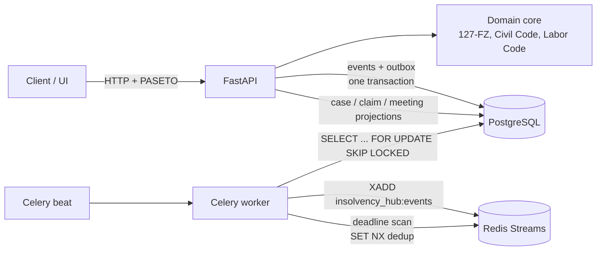

# InsolvencyHub

Bankruptcy-case workspace under Федеральный закон от 26.10.2002 № 127-ФЗ: procedures, the creditors' claims register with statutory priority, creditors' meetings with quorum and vote counting, and procedural deadlines on the production calendar. Every decision is returned together with the norm it rests on.

---

## What this is

A FastAPI service for an insolvency practitioner running many cases at once. The domain rejects the routine mistakes that usually come from spreadsheets:

- a claim entered in the register before the objection period has expired (п. 2 ст. 71, п. 3 ст. 100);
- a late creditor given a vote at the first meeting (п. 1 ст. 71, п. 2 ст. 72);
- a secured creditor voting in bankruptcy proceedings on a question where that creditor has no vote (п. 1 ст. 12);
- a penalty paid ahead of the principal of a third-rank claim (п. 3 ст. 137);
- a deadline that ends on a non-working day left unmoved (ст. 193 ГК РФ), including days that are days off only by government decree (31.12.2026, 05.11.2027).

Capabilities:

- **Procedures.** Separate transition machines for a legal entity (ст. 27) and a citizen (ст. 213.2). An illegal transition is rejected with the article cited.
- **Claims register.** Rank is assigned under п. 4 ст. 134 and п. 3 ст. 213.27. Third-rank sanctions are tracked separately (п. 3 ст. 137). Late claims fall into the behind-the-register queue (п. 4 ст. 142). Consideration is blocked until the 30-day objection period expires. Claims filed late during supervision are considered only after the next procedure (п. 7 ст. 71).
- **Calculations.** Estate distribution: current payments under п. 1.1 and п. 2 ст. 134, then the register by rank, pro rata (п. 3 ст. 142), with a reserve for disputed claims (п. 6 ст. 142). Proceeds of collateral are split 70/20/10 and 80/15/5 (п. 1, 2 and 2.1 ст. 138). Amounts are divided in kopecks by the largest-remainder method, so kopecks are not dropped.
- **Creditors' meetings.** Votes are proportional to third-rank principal and interest, excluding sanctions (п. 3 ст. 12). Secured creditors' voting rights depend on the procedure and the question (п. 1 ст. 12, п. 4 ст. 213.10). Quorum is 50%, or 30% for a repeated meeting (п. 4 ст. 12). Resolutions pass by a majority of those present (п. 1 ст. 15) or by a majority of all votes (п. 2 ст. 15). Proper notice (ст. 13, п. 5 ст. 213.8) and a valid convening demand (ст. 14) are checked.
- **Deadlines.** Rules of ст. 191–193 ГК РФ and the production calendar under ст. 112 ТК РФ, including transferred days off. Before a meeting the service computes notice periods; after a meeting it computes the protocol, EFRSB publication and appeal periods. Upcoming-deadline reminders go to a Redis Stream without duplicates.
- **Audit.** Event sourcing: every change is stored as an event and is readable at `/api/v1/cases/{id}/events`. Optimistic locking uses `ETag` / `If-Match`.

Stack: Python 3.14, FastAPI 0.143, Pydantic 2.14, SQLAlchemy 2.1, Alembic 1.20, asyncpg 0.32, Celery 5.6, Redis, PostgreSQL 17, structlog, pyseto, bcrypt, uv.

---

## Architecture at a glance



| Layer | Package | Contents |
|---|---|---|
| Domain | `insolvency_hub.domain` | `InsolvencyCase` aggregate, priority, distribution, voting, deadlines, calendar, norm catalogue with quotations. No database or web imports |
| Application | `insolvency_hub.application` | Command service with version checks, outbox relay, deadline scanner, projection rebuild |
| Infrastructure | `insolvency_hub.infrastructure` | SQLAlchemy 2.1 (asyncpg), event store unique on `(aggregate_id, version)`, Redis Streams, Celery |
| API | `insolvency_hub.api` | FastAPI, PASETO v4.local, roles `admin` / `manager` / `creditor` / `auditor`, isolation by organisation |

---

## Quick start

### Prerequisites

- Docker + Docker Compose v2
- `make`
- `curl`

### Go

```bash
git clone <this-repo> InsolvencyHub && cd InsolvencyHub
make setup
```

One command creates `.env` (secrets generated), builds images, starts the stack (API, Postgres, Redis, Celery worker and beat), applies migrations and waits for health.

| What | URL |
|------|-----|
| API | http://127.0.0.1:20500 |
| Docs | http://127.0.0.1:20500/docs |
| Health | http://127.0.0.1:20500/health |
| Ready | http://127.0.0.1:20500/health/ready |

Demo data: `make seed`. Fictitious debtor ООО «Вымышленный Завод», ИНН 0000000018, case А00-101/2026. Password is `IH_DEMO_PASSWORD` (default `demo-password`).

| Email | Role |
|-------|------|
| admin@demo.invalid | admin |
| manager@demo.invalid | manager |
| creditor@demo.invalid | creditor |
| auditor@demo.invalid | auditor |

```bash
TOKEN=$(curl -s -X POST localhost:20500/api/v1/auth/login -H 'content-type: application/json' \
  -d '{"email":"manager@demo.invalid","password":"demo-password"}' | jq -r .access_token)
curl -s localhost:20500/api/v1/cases -H "Authorization: Bearer $TOKEN"
```

On the host, without Docker (PostgreSQL and Redis must already be running):

```bash
uv sync
uv run alembic upgrade head
uv run python scripts/seed_demo.py
uv run uvicorn insolvency_hub.main:app --port 20500
uv run celery -A insolvency_hub.infrastructure.worker:celery_app worker -B
```

In production set `IH_ENV=prod` and your own `IH_PASETO_KEY_HEX`:

```bash
python -c "import secrets; print(secrets.token_hex(32))"
```

The application refuses to start in `prod` with the built-in development key.

---

## Non-standard ports (intentional)

| Service | Host port | Notes |
|---------|-----------|-------|
| API | **20500** | published on `127.0.0.1` (container listens on 8000) |
| PostgreSQL | **20501** | only via `docker-compose.debug.yml` |
| Redis | **20502** | only via `docker-compose.debug.yml` |

Postgres and Redis are not published by default, so this stack can sit next to other portfolio projects. Override via `*_HOST_PORT` in `.env`.

```bash
docker compose -f docker-compose.yml -f docker-compose.debug.yml up -d
```

---

## Make targets

| Target | Purpose |
|--------|---------|
| `make setup` | Full install from a fresh clone |
| `make up` / `make down` | Start / stop the stack (data kept) |
| `make logs` / `make ps` | Tail logs (`make logs s=api`) / show status |
| `make migrate` / `make seed` | Migrations / demo data |
| `make check-migrations` | `alembic check` |
| `make test` / `make lint` / `make typecheck` | Containerised pytest / ruff / strict mypy |
| `make fmt` | `ruff format` and `ruff check --fix` |
| `make shell` | Shell in the API container |
| `make clean` | Remove containers, volumes and local images for this project |
| `make local-install` / `local-test` / `local-lint` | Host-side uv workflow |

---

## API overview

Mutating requests take `If-Match: "<version>"` and return an `ETag`. Domain errors use `{"error", "message", "basis": {"code", "reference", "act"}}`. Auth is `Authorization: Bearer <paseto>`. OpenAPI is at `/docs`.

Health probes sit outside `/api/v1`. Everything else is under `/api/v1`.

| Area | Paths |
|------|-------|
| Health | `GET /health`, `GET /health/ready` |
| Auth | `POST /api/v1/auth/login`, `GET /api/v1/auth/me` |
| Reference | `GET /reference/norms`, `GET /reference/norms/{code}`, `GET /reference/procedures/{debtor_kind}`, `GET /reference/calendar/{year}`, `POST /reference/terms`, `POST /reference/petition-check`, `POST /reference/collateral` |
| Cases | `POST /cases`, `GET /cases`, `GET /cases/{id}`, `GET /cases/{id}/events`, `POST /cases/{id}/transitions`, `POST /cases/{id}/publications`, `POST /cases/{id}/manager`, `GET /cases/{id}/deadlines` |
| Claims | `POST/GET /cases/{id}/claims`, `GET /cases/{id}/claims/{claim_id}`, `POST .../objections`, `POST .../ruling`, `POST .../exclusion`, `POST .../payments` |
| Register and calculations | `GET /cases/{id}/registry`, `GET /cases/{id}/registry.csv`, `GET /exports/registry/{id}`, `POST /cases/{id}/distribution`, `POST /cases/{id}/collateral` |
| Meetings | `POST/GET /cases/{id}/meetings`, `GET /cases/{id}/meetings/{mid}`, `GET .../terms`, `POST .../notices`, `POST .../participants`, `POST .../ballots`, `POST .../conclusion`, `POST .../cancellation`, `POST/GET /cases/{id}/requisitions` |
| Admin | `GET /admin/outbox`, `POST /admin/projections/rebuild` |

Reference, case, claim, meeting, export and admin paths above are relative to `/api/v1`.

---

## Testing

```bash
make test          # pytest in Compose against Postgres + Redis
make lint          # ruff check + format --check
make typecheck     # mypy, strict
uv run pytest --cov   # host; integration tests need the variables below
```

- **Domain unit tests** cover every module. Hypothesis checks the invariants: a pro-rata split sums to the funds available, no share exceeds the claim, a later rank receives nothing until the previous rank is paid, a collateral split balances to the kopeck, quorum fires strictly above the threshold, a deadline ends on a working day, and ИНН / ОГРН checksums hold.
- **Calendars** for 2026 and 2027 are checked against the official calendars (247 working days each).
- **API and integration tests** run on real PostgreSQL and Redis (`IH_TEST_DATABASE_URL`, `IH_TEST_REDIS_URL`). They cover migrations up and down, two writers racing (version conflict), an outbox using `SKIP LOCKED` with no duplicates across six parallel relays, reminder deduplication, projection rebuild and Celery tasks. Without those variables the integration tests are skipped. `.env.example` points them at the Compose network; the debug overlay publishes Postgres on **20501** and Redis on **20502**.
- **Norm catalogue.** A separate test checks that every norm code the code cites exists in the catalogue with a quotation.

---

## Limitations

- The production calendar is verified only for 2026 and 2027. Other years use ст. 112 ТК РФ and weekends without government transfers, and the deadline is marked `calendar_verified: false`.
- Periods phrased as "no later than N days before" (meeting notices) are not shifted under ст. 193 ГК РФ: that article governs the end of a period, not its start.
- Behind-the-register claims (п. 4 ст. 134 and ст. 61.2 / 61.3, п. 2.1 ст. 134, п. 4 ст. 142) are pooled into one pro-rata group: the statute does not rank them against each other.
- Secured claims are excluded from estate distribution and calculated separately under ст. 138. The part not paid from the collateral has to be placed in the third rank by hand.
- In financial rehabilitation, claims are handled by analogy with ст. 100 (consideration no earlier than 30 days after filing). A dedicated norm for that procedure was not checked.
- The special majority under ст. 146 (moving from bankruptcy proceedings to external administration) and the vote on a restructuring plan (ст. 213.16) were not checked. Questions `restructuring_plan` and `transition_to_external_management` follow the general rule of п. 1 ст. 15: a majority of the votes of those present.
- Quorum for ordinary questions is counted on votes. If a secured creditor votes only on part of the agenda, quorum is checked without that creditor's votes.
- There is no integration with EFRSB, Kommersant or the arbitration case file. Publication dates and court acts are entered manually.
- A settlement agreement, subsidiary liability, transaction challenges and auctions are not modelled. Only their effects on the register are recorded: the behind-the-register queue and termination of the procedure.
- Amendments in Федеральный закон от 26.07.2026 № 253-ФЗ take effect on 27.07.2027 and are not applied.
- Quotations are shortened and are there for navigation. The service is a tool; it does not replace counsel.

---

## Legal basis

Texts checked on 16.10.2026 against ConsultantPlus.

**Федеральный закон от 26.10.2002 № 127-ФЗ «О несостоятельности (банкротстве)», ред. от 04.08.2026** (latest amendments: Федеральный закон от 04.08.2026 № 283-ФЗ):

| Topic | Articles |
|---|---|
| Definitions, bankruptcy creditors, monetary obligation | ст. 2, 4 |
| Insolvency signs and thresholds | ст. 3, п. 2 ст. 33 (2 000 000 руб. for a legal entity), п. 2 ст. 213.3 (500 000 руб. for a citizen) |
| Current payments | ст. 5, пп. 1, 1.1, 2 ст. 134 |
| Creditors' meeting | ст. 12 (votes, quorum, minutes), ст. 13 (notice: 14 days by post, 5 working days by another means, EFRSB 14 days ahead), ст. 14 (convening on a demand of 10% / one third, 3 weeks), ст. 15 (majority of those present or of all votes; appeal within 20 days of the decision) |
| Claims register | ст. 16 (inclusion and exclusion by court ruling), ст. 71 (30 days in supervision, objections, п. 7 late claims), ст. 72 (first meeting), ст. 100 (financial rehabilitation and external administration), ст. 142 (register closes after 2 months, pro rata, п. 4 late claims, п. 6 reserve) |
| Procedures | ст. 27, 51 (7 months), 62, 75, 80 (financial rehabilitation up to 2 years), 93 (external administration 18 + 6 months), 124 (bankruptcy proceedings 6 + 6 months), 128 (publication within 10 days) |
| Priority and collateral | п. 4 ст. 134, п. 3 ст. 137, ст. 138 (70/20/10, 80/15/5, п. 2.1) |
| Citizen bankruptcy | ст. 213.1, 213.2, 213.7, 213.8 (2 months, meeting notice), 213.10 (secured creditor votes), 213.14, 213.24 (6 months, extendable), 213.27 (alimony in the first rank) |

**Other acts:**

- Гражданский кодекс РФ (часть первая), ред. от 10.06.2026: ст. 191, п. 3 ст. 192, ст. 193.
- Арбитражный процессуальный кодекс РФ, ред. от 15.12.2025: ч. 3 ст. 113, ч. 4 ст. 114.
- Трудовой кодекс РФ, ред. от 25.05.2026: ст. 112 (non-working public holidays and transferred days off).
- Постановление Правительства РФ от 24.09.2025 № 1466 (weekend transfers in 2026).
- Постановление Правительства РФ от 17.09.2026 № 1187 (weekend transfers in 2027).

Full catalogue with quotations: `GET /api/v1/reference/norms`.

---

## License

MIT
