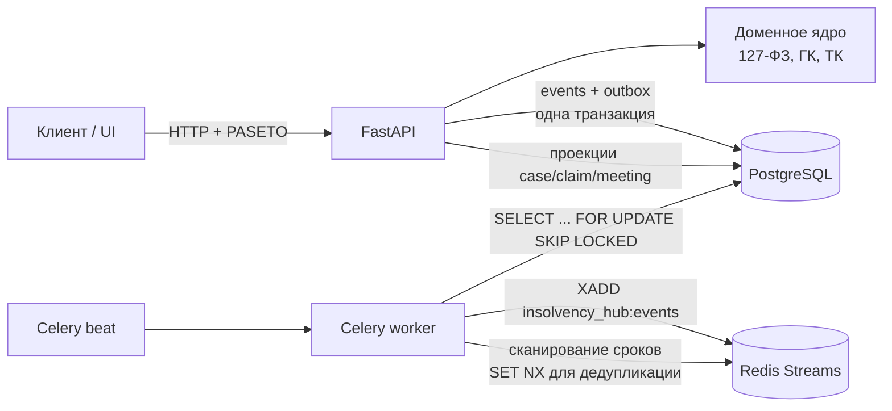

# InsolvencyHub

Сервис ведения дела о банкротстве по Федеральному закону от 26.10.2002 № 127-ФЗ: процедуры, реестр требований кредиторов с очередностью, собрания кредиторов с подсчетом кворума и голосов, процессуальные сроки по производственному календарю. Каждое решение системы возвращается вместе с нормой закона, на которой оно основано.

## Проблема

Арбитражный управляющий ведет десятки дел одновременно. Ошибки обычно возникают не в сложных вопросах, а в рутине:

- требование включили в реестр раньше, чем истек срок на возражения (п. 2 ст. 71, п. 3 ст. 100);
- кредитору, опоздавшему с требованием, дали голос на первом собрании (п. 1 ст. 71, п. 2 ст. 72);
- залоговый кредитор проголосовал в конкурсном производстве по вопросу, по которому у него нет голоса (п. 1 ст. 12);
- неустойку погасили раньше основного долга третьей очереди (п. 3 ст. 137);
- срок, оканчивающийся в нерабочий день, не перенесли (ст. 193 ГК РФ), а 31.12.2026 и 05.11.2027 забыли, потому что они выходные только по постановлениям Правительства.

## Решение

- **Процедуры.** Конечный автомат переходов отдельно для юридического лица (ст. 27) и гражданина (ст. 213.2). Недопустимый переход отклоняется со ссылкой на статью.
- **Реестр требований.** Очередь назначается по п. 4 ст. 134 и п. 3 ст. 213.27. Санкции третьей очереди учитываются отдельно (п. 3 ст. 137). Опоздавшие требования попадают в зареестровую очередь (п. 4 ст. 142). Рассмотрение блокируется до истечения 30-дневного срока на возражения. Опоздавшие в наблюдении рассматриваются только после следующей процедуры (п. 7 ст. 71).
- **Расчеты.** Распределение конкурсной массы: текущие платежи по п. 1.1 и 2 ст. 134, затем реестр по очередям пропорционально (п. 3 ст. 142), резерв по спорным требованиям (п. 6 ст. 142). Распределение выручки от предмета залога 70/20/10 и 80/15/5 (п. 1, 2 и 2.1 ст. 138). Суммы делятся в копейках методом наибольших остатков, поэтому копейки не теряются.
- **Собрания кредиторов.** Голоса считаются пропорционально основному долгу и процентам третьей очереди без санкций (п. 3 ст. 12). Учитываются право голоса залоговых кредиторов по процедуре и вопросу (п. 1 ст. 12, п. 4 ст. 213.10) и кворум 50 % / 30 % для повторного собрания (п. 4 ст. 12). Решения принимаются большинством присутствующих (п. 1 ст. 15) или большинством от общего числа голосов (п. 2 ст. 15). Проверяется надлежащее уведомление (ст. 13, п. 5 ст. 213.8) и требование о созыве (ст. 14).
- **Сроки.** Реализованы правила ст. 191–193 ГК РФ и производственный календарь по ст. 112 ТК РФ с переносами выходных. Перед собранием считаются сроки уведомлений, после собрания — сроки протокола, публикации в ЕФРСБ и обжалования. Напоминания о приближающихся сроках уходят в Redis Stream без дублей.
- **Аудит.** Event sourcing: каждое изменение хранится как событие и доступно через `/events`. Оптимистическая блокировка работает через `ETag` / `If-Match`.

## Архитектура



| Слой | Пакет | Содержание |
|---|---|---|
| Домен | `insolvency_hub.domain` | Агрегат `InsolvencyCase`, очередность, распределение, голосование, сроки, календарь, каталог норм с цитатами. Без зависимостей от БД и веба |
| Приложение | `insolvency_hub.application` | Сервис команд с проверкой версии, outbox-релей, сканер сроков, перестроение проекций |
| Инфраструктура | `insolvency_hub.infrastructure` | SQLAlchemy 2.1 (asyncpg), event store с уникальностью `(aggregate_id, version)`, Redis Streams, Celery |
| API | `insolvency_hub.api` | FastAPI, PASETO v4.local, роли `admin` / `manager` / `creditor` / `auditor`, изоляция по организации |

Стек: Python 3.14, FastAPI 0.143, Pydantic 2.14, SQLAlchemy 2.1, Alembic 1.20, asyncpg 0.32, Celery 5.6, Redis, PostgreSQL 17, structlog, pyseto, bcrypt, uv.

## Быстрый старт

Требования: Docker, Docker Compose v2, make, curl.

```bash
git clone <repo-url> InsolvencyHub && cd InsolvencyHub
make setup
```

Одна команда создаёт `.env` (секреты генерируются), собирает образы, поднимает стек (API, Postgres, Redis, Celery worker + beat), применяет миграции и ждёт health.

| Что | URL |
|---|---|
| API | http://127.0.0.1:20500 |
| Docs | http://127.0.0.1:20500/docs |
| Health | http://127.0.0.1:20500/health |

Полезные команды: `make help`, `make test`, `make lint`, `make typecheck`, `make seed`, `make down`, `make clean`. Порты меняются через `*_HOST_PORT` в `.env` (см. `.env.example`). Postgres/Redis по умолчанию не опубликованы на хост; для отладки: `docker compose -f docker-compose.yml -f docker-compose.debug.yml up -d`.

Демо-данные: `make seed`. ООО «Вымышленный Завод», ИНН 0000000018, дело А00-101/2026. Пользователи `manager@demo.invalid`, `admin@demo.invalid`, `creditor@demo.invalid`, `auditor@demo.invalid`, пароль из `IH_DEMO_PASSWORD` (по умолчанию `demo-password`).

```bash
TOKEN=$(curl -s -X POST localhost:20500/api/v1/auth/login -H 'content-type: application/json' \
  -d '{"email":"manager@demo.invalid","password":"demo-password"}' | jq -r .access_token)
curl -s localhost:20500/api/v1/cases -H "Authorization: Bearer $TOKEN"
```

Локально без Docker (нужны PostgreSQL и Redis на хосте):

```bash
uv sync
uv run alembic upgrade head
uv run python scripts/seed_demo.py
uv run uvicorn insolvency_hub.main:app --port 20500
uv run celery -A insolvency_hub.infrastructure.worker:celery_app worker -B
```

В production задайте `IH_ENV=prod` и собственный ключ `IH_PASETO_KEY_HEX`: `python -c "import secrets; print(secrets.token_hex(32))"`. Со встроенным dev-ключом приложение в режиме prod не запустится.

## API

Все изменяющие запросы принимают `If-Match: "<версия>"` и возвращают `ETag`. Ошибки домена возвращаются в формате `{"error", "message", "basis": {"code", "reference", "act"}}`.

| Группа | Эндпоинты |
|---|---|
| Служебные | `GET /health`, `GET /health/ready` |
| Аутентификация | `POST /api/v1/auth/login`, `GET /api/v1/auth/me` |
| Справочники | `GET /reference/norms`, `GET /reference/norms/{code}`, `GET /reference/procedures/{debtor_kind}`, `GET /reference/calendar/{year}`, `POST /reference/terms`, `POST /reference/petition-check`, `POST /reference/collateral` |
| Дела | `POST /cases`, `GET /cases`, `GET /cases/{id}`, `GET /cases/{id}/events`, `POST /cases/{id}/transitions`, `POST /cases/{id}/publications`, `POST /cases/{id}/manager`, `GET /cases/{id}/deadlines` |
| Требования | `POST/GET /cases/{id}/claims`, `GET /claims/{claim_id}`, `POST .../objections`, `POST .../ruling`, `POST .../exclusion`, `POST .../payments` |
| Реестр и расчеты | `GET /cases/{id}/registry`, `GET /cases/{id}/registry.csv`, `GET /exports/registry/{id}`, `POST /cases/{id}/distribution`, `POST /cases/{id}/collateral` |
| Собрания | `POST/GET /cases/{id}/meetings`, `GET /meetings/{mid}`, `GET .../terms`, `POST .../notices`, `POST .../participants`, `POST .../ballots`, `POST .../conclusion`, `POST .../cancellation`, `POST/GET /cases/{id}/requisitions` |
| Администрирование | `GET /admin/outbox`, `POST /admin/projections/rebuild` |

Полная схема OpenAPI доступна по адресу `/docs`.

## Тесты

```bash
uv run pytest --cov
```

- **Юнит-тесты домена.** Покрывают все модули. Hypothesis проверяет инварианты: сумма пропорционального деления равна доступным средствам, каждая доля не больше требования, следующая очередь не получает денег, пока предыдущая не погашена, распределение залога сходится до копейки, кворум срабатывает строго выше порога, сроки оканчиваются в рабочий день, контрольные суммы ИНН и ОГРН.
- **Календари.** Календари 2026 и 2027 сверены с официальными (по 247 рабочих дней).
- **API- и интеграционные тесты.** Работают на настоящих PostgreSQL и Redis: `IH_TEST_DATABASE_URL`, `IH_TEST_REDIS_URL`. Проверяются миграции вверх и вниз, гонка двух писателей (конфликт версий), outbox с `SKIP LOCKED` без дублей при шести параллельных релеях, дедупликация напоминаний, перестроение проекций и задачи Celery. Без этих переменных интеграционные тесты пропускаются.
- **Каталог норм.** Отдельный тест проверяет, что каждый код нормы, на который ссылается код, есть в каталоге с цитатой.

## Ограничения

- Производственный календарь сверен только на 2026 и 2027 годы. Для других лет считаются ст. 112 ТК РФ и выходные без переносов Правительства, а у срока выставляется `calendar_verified: false`.
- Сроки «не позднее чем за N дней до» (уведомления о собрании) не переносятся по ст. 193 ГК РФ: эта статья регулирует окончание срока, а не его начало.
- Зареестровые требования (п. 4 ст. 134 и ст. 61.2/61.3, п. 2.1 ст. 134, п. 4 ст. 142) объединены в одну пропорциональную группу: закон не устанавливает их очередность между собой.
- Залоговые требования исключены из распределения конкурсной массы и считаются отдельно по ст. 138. Требования, не погашенные за счет предмета залога, нужно учитывать в третьей очереди вручную.
- В финансовом оздоровлении требования учитываются по аналогии со ст. 100 (рассмотрение не ранее 30 дней после предъявления). Отдельная норма для этой процедуры не сверялась.
- Особое большинство по ст. 146 (переход из конкурсного производства во внешнее управление) и голосование по плану реструктуризации (ст. 213.16) не сверялись. Вопросы `restructuring_plan` и `transition_to_external_management` решаются по общему правилу п. 1 ст. 15: большинством голосов присутствующих.
- Кворум считается по голосам для обычных вопросов. Если залоговый кредитор голосует только по части вопросов повестки, кворум проверяется без его голосов.
- Нет интеграции с ЕФРСБ, «Коммерсантом» и картотекой арбитражных дел: даты публикаций и судебных актов вводятся вручную.
- Мировое соглашение, субсидиарная ответственность, оспаривание сделок и торги не моделируются. Отражаются только их последствия для реестра: зареестровая очередь и прекращение процедуры.
- Изменения из Федерального закона от 26.07.2026 № 253-ФЗ вступают в силу 27.07.2027 и не учтены.
- Сервис не заменяет юриста. Цитаты норм сокращены и даны для навигации.

## Правовая основа

Тексты сверены 16.10.2026 по КонсультантПлюс.

**Федеральный закон от 26.10.2002 № 127-ФЗ «О несостоятельности (банкротстве)», ред. от 04.08.2026** (последние изменения — Федеральный закон от 04.08.2026 № 283-ФЗ):

| Тема | Статьи |
|---|---|
| Понятия, конкурсные кредиторы, денежное обязательство | ст. 2, 4 |
| Признаки банкротства и пороги | ст. 3, п. 2 ст. 33 (2 000 000 руб. для ЮЛ), п. 2 ст. 213.3 (500 000 руб. для гражданина) |
| Текущие платежи | ст. 5, пп. 1, 1.1, 2 ст. 134 |
| Собрание кредиторов | ст. 12 (голоса, кворум, протокол), ст. 13 (уведомление: 14 дней по почте, 5 рабочих дней иным способом, ЕФРСБ за 14 дней), ст. 14 (созыв по требованию 10 % / одной трети, 3 недели), ст. 15 (большинство присутствующих или от общего числа голосов, обжалование 20 дней с даты решения) |
| Реестр требований | ст. 16 (включение и исключение по определению суда), ст. 71 (30 дней в наблюдении, возражения, п. 7 опоздавшие), ст. 72 (первое собрание), ст. 100 (ФО и ВУ), ст. 142 (закрытие реестра через 2 месяца, пропорциональность, п. 4 опоздавшие, п. 6 резерв) |
| Процедуры | ст. 27, 51 (7 месяцев), 62, 75, 80 (ФО до 2 лет), 93 (ВУ 18 + 6 месяцев), 124 (КП 6 + 6 месяцев), 128 (публикация в течение 10 дней) |
| Очередность и залог | п. 4 ст. 134, п. 3 ст. 137, ст. 138 (70/20/10, 80/15/5, п. 2.1) |
| Банкротство гражданина | ст. 213.1, 213.2, 213.7, 213.8 (2 месяца, уведомление о собрании), 213.10 (залоговый кредитор голосует), 213.14, 213.24 (6 месяцев с продлением), 213.27 (алименты в первой очереди) |

**Иные акты:**

- Гражданский кодекс РФ (часть первая), ред. от 10.06.2026: ст. 191, п. 3 ст. 192, ст. 193.
- Арбитражный процессуальный кодекс РФ, ред. от 15.12.2025: ч. 3 ст. 113, ч. 4 ст. 114.
- Трудовой кодекс РФ, ред. от 25.05.2026: ст. 112 (нерабочие праздничные дни и перенос выходных).
- Постановление Правительства РФ от 24.09.2025 № 1466 (перенос выходных в 2026 году).
- Постановление Правительства РФ от 17.09.2026 № 1187 (перенос выходных в 2027 году).

Полный каталог с цитатами: `GET /api/v1/reference/norms`.

## Лицензия

MIT
